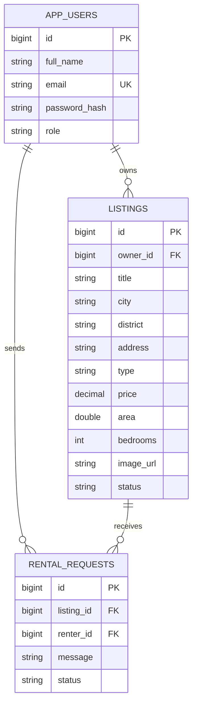

# EasyHome – Website cho thuê nhà

**Đồ án EasyHome (In-house)** – Bản MVP full-stack gồm **Spring Boot REST API + React/Vite + Node.js/npm + H2/MySQL + Docker**. Giao diện tiếng Việt, responsive.

## 1. Chức năng đã có

| Vai trò | Chức năng |
|---|---|
| Khách chưa đăng nhập | Xem danh sách nhà, tìm theo từ khóa/thành phố/loại nhà/khoảng giá, xem chi tiết |
| Người thuê (RENTER) | Đăng ký, đăng nhập, gửi yêu cầu thuê, xem trạng thái yêu cầu |
| Chủ nhà (OWNER) | Đăng ký, đăng nhập, thêm/sửa/ẩn/hiện lại tin đăng, xem và xử lý yêu cầu thuê |
| Hệ thống | Xác thực JWT (hạn 12 giờ), mã hóa mật khẩu BCrypt, dữ liệu mẫu, kiểm tra quyền truy cập |

**Quy tắc:** Người thuê không được đăng tin; chủ nhà không được gửi yêu cầu thuê. Chỉ chủ sở hữu được sửa tin và xử lý yêu cầu của tin đó. Khi chủ nhà chấp nhận một yêu cầu, nhà chuyển thành **Đã cho thuê**, các yêu cầu đang chờ khác của nhà đó được từ chối.

> Đây là **MVP demo**, chưa có thanh toán, chat, hợp đồng điện tử, upload ảnh lên cloud, bản đồ thực, đăng nhập Google hay kiểm duyệt Admin. Ảnh là URL do chủ nhà nhập, hình demo dùng Unsplash. Không dùng thông tin hoặc mật khẩu demo khi triển khai thật.

## 2. Cấu trúc source

```text
EasyHome/
├── backend/
│   ├── pom.xml
│   ├── src/main/java/com/easyhome/
│   │   ├── EasyHomeApplication.java
│   │   ├── auth/              # Login, register, JWT
│   │   ├── config/            # Security, seed mẫu
│   │   ├── model/             # User, Listing, RentalRequest
│   │   ├── repository/        # Spring Data JPA
│   │   ├── listing/           # API nhà
│   │   ├── rental/            # API yêu cầu thuê
│   │   └── common/            # Tài khoản hiện tại, lỗi API
│   └── src/main/resources/application.yml
├── frontend/
│   ├── package.json
│   ├── vite.config.js
│   └── src/
│       ├── App.jsx             # Trang chủ, nhà, đăng nhập, dashboard
│       ├── api.js              # REST client
│       └── style.css           # Giao diện responsive
├── docker-compose.yml
└── start-dev.bat
```

## 3. Cách chạy nhanh trên Windows – không cần cài MySQL

Yêu cầu: **Java JDK 21**, **Apache Maven 3.9+** (`mvn -v`), **Node.js 22+** và npm (`node -v`). Nếu đã có Maven/Java/Node.js, chỉ cần giải nén ZIP.

**Cách A: nhấp đúp `start-dev.bat`**. Script mở hai cửa sổ terminal: một chạy backend và một chạy frontend. Lần đầu cần Internet để Maven/npm tải thư viện.

**Cách B: chạy thủ công hai terminal ở thư mục EasyHome:**

Terminal 1:

```powershell
cd backend
mvn spring-boot:run
```

Terminal 2:

```powershell
cd frontend
npm install
npm run dev
```

- Web React: **http://localhost:5173**
- Backend REST API: **http://localhost:8080/api/listings**
- H2 dùng **file `backend/data/easyhome.mv.db`** (được tạo khi khởi chạy lần đầu). Dữ liệu được giữ lại sau khi tắt ứng dụng.
- H2 console (chỉ bản chạy local): **http://localhost:8080/h2-console**. JDBC URL: `jdbc:h2:file:./data/easyhome;DB_CLOSE_ON_EXIT=FALSE`, user `sa`, mật khẩu trống. Lưu ý console có thể hiển thị lỗi kết nối file nếu database đang mở ở process khác; nên sử dụng trực tiếp ứng dụng để xem dữ liệu.

### Tài khoản demo

| Vai trò | Email | Mật khẩu |
|---|---|---|
| Chủ nhà | `owner@easyhome.vn` | `123456` |
| Người thuê | `khach@easyhome.vn` | `123456` |

Hệ thống tự tạo 6 tin đăng mẫu trong lần chạy đầu trên **database mới**.

## 4. Chạy toàn bộ bằng Docker + MySQL

Yêu cầu: Docker Desktop đang chạy. Dùng cách này nếu chưa cài Java/Maven/Node.js hoặc muốn chạy bằng MySQL. **Không chạy đồng thời với cách local** nếu cổng 8080 bị chiếm.

```powershell
# Từ thư mục EasyHome
copy .env.example .env
# Mở .env và đổi các mật khẩu/secret

docker compose up --build -d
```

Mở **http://localhost:3000**. Các cổng:

| Dịch vụ | Cổng |
|---|---|
| React + Nginx | `3000` |
| Spring Boot | `8080` |
| MySQL | `3307` (host) -> `3306` (container) |

Kết nối MySQL từ Workbench: `localhost:3307`, user `easyhome`, password trong file `.env`, database `easyhome`. Spring Boot sẽ tạo bảng bằng Hibernate JPA ở lần chạy đầu. Dữ liệu MySQL tồn tại trong volume Docker `mysql_data`.

Dừng hệ thống:

```powershell
docker compose down
```

Xem log backend:

```powershell
docker compose logs -f backend
```

## 5. API chính

| HTTP | Endpoint | Quyền | Mô tả |
|---|---|---|---|
| POST | `/api/auth/register` | Công khai | Đăng ký RENTER hoặc OWNER |
| POST | `/api/auth/login` | Công khai | Đăng nhập, nhận JWT |
| GET | `/api/auth/me` | Đăng nhập | Thông tin user |
| GET | `/api/listings?q=&city=&type=&minPrice=&maxPrice=` | Công khai | Danh sách, bộ lọc |
| GET | `/api/listings/{id}` | Công khai | Chi tiết tin đang hiển thị |
| GET | `/api/listings/mine` | OWNER | Tin của chủ nhà |
| POST | `/api/listings` | OWNER | Thêm tin |
| PUT | `/api/listings/{id}` | OWNER sở hữu tin | Sửa tin |
| DELETE | `/api/listings/{id}` | OWNER sở hữu tin | Ẩn tin (soft delete) |
| PATCH | `/api/listings/{id}/restore` | OWNER sở hữu tin | Hiện lại tin ẩn |
| POST | `/api/requests` | RENTER | Gửi yêu cầu thuê |
| GET | `/api/requests/mine` | RENTER | Yêu cầu đã gửi |
| GET | `/api/requests/received` | OWNER | Yêu cầu nhận được |
| PATCH | `/api/requests/{id}/status` | OWNER sở hữu tin | ACCEPTED / REJECTED |

Các API yêu cầu đăng nhập cần header: `Authorization: Bearer <jwt>`.

**Ví dụ đăng nhập với PowerShell (Windows):**

```powershell
$body = @{ email = 'owner@easyhome.vn'; password = '123456' } | ConvertTo-Json
Invoke-RestMethod -Uri http://localhost:8080/api/auth/login -Method Post -ContentType 'application/json' -Body $body
```

**Ví dụ đăng tin JSON:**

```json
{
  "title": "Căn hộ 2 phòng ngủ",
  "description": "Nội thất cơ bản, gần trường đại học",
  "city": "Hà Nội",
  "district": "Cầu Giấy",
  "address": "Dịch Vọng, Cầu Giấy, Hà Nội",
  "type": "Căn hộ",
  "price": 8500000,
  "area": 65,
  "bedrooms": 2,
  "imageUrl": "https://example.com/photo.jpg"
}
```

## 6. Database / ERD rút gọn



## 7. Lưu ý trước khi triển khai thật

- Dùng **JWT_SECRET** dài, ngẫu nhiên; không để secret trong source; tắt **SEED_DEMO** và tắt H2 console ngoài môi trường dev.
- Demo lưu JWT trong `localStorage` để đơn giản. Khi triển khai thực tế, cân nhắc BFF hoặc cookie `HttpOnly`, `Secure`, `SameSite` cùng biện pháp chống CSRF thích hợp.
- Bật HTTPS, hạn chế CORS, kiểm tra dữ liệu, hạn mức request, chống spam, reset mật khẩu, xác minh email, upload ảnh an toàn, log/monitoring, backup DB, migration Flyway/Liquibase.
- Bản MVP không bảo đảm tính đúng đắn khi 2 chủ nhà/tiến trình chấp nhận cùng một tin **đồng thời**; môi trường thực tế cần optimistic/pessimistic locking và test concurrency.
- `ddl-auto=update` phù hợp demo; production dùng migration và `validate`.
- Trước khi deploy, cập nhật dependencies được hỗ trợ và quét lỗ hổng.

**Lộ trình mở rộng theo EasyHome In-house:** Admin và kiểm duyệt tin, quản lý tài khoản, upload nhiều ảnh, danh sách yêu thích, bản đồ, chat, lịch hẹn xem nhà, hợp đồng, thanh toán, thống kê dashboard, phân quyền chi tiết và CI/CD Jenkins.
